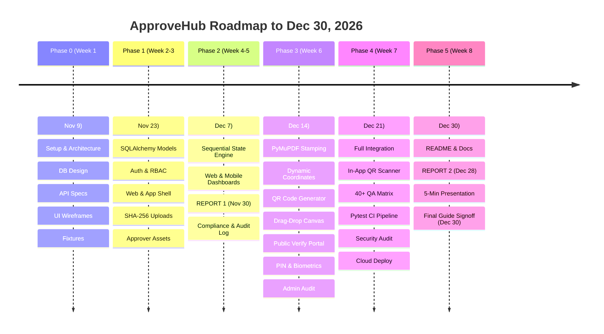

# 🚀 ApproveHub — Master Engineering Roadmap (2026)

> **Course:** EDI1 (ES26102), F.Y. B.Tech Information Technology, VIT Pune  
> **Team Leader:** Shreeyash Solunke ([@ShreeyashSolunke08](https://github.com/ShreeyashSolunke08))  
> **Team Members:** Shreeyash Solunke, Shravani Borse ([@shravaniborse9](https://github.com/shravaniborse9)), Shreya Sutar ([@SHREE7682](https://github.com/SHREE7682)), Shreya Loya ([@loyashreya200408](https://github.com/loyashreya200408))  
> **Project Target Deadline:** 🎯 **December 30, 2026** (100% Completion, Deployed & Evaluated)  
> **Total Sequential Tasks:** **47 Steps** (Strict 1 → 47 Flow)  
> **Total Workload Points:** **229 Effort Points** (Equally Distributed)

---

## 🗺️ Master Phase & Timeline Overview

---

## 📑 Dual College Project Reports

| Report | Milestone | Deadline | Lead Authors | Key Required Contents | GitHub Issue |
| :--- | :---: | :---: | :--- | :--- | :---: |
| **Project Report 1 (Mid-Term Review)** | **Week 4** | **Nov 30, 2026** | Shreya Loya & Shreeyash | System Architecture, ER schema, API specifications, Figma wireframes, initial auth & upload screenshots | [Issue #54](https://github.com/ShreeyashSolunke08/ApproveHub/issues/54) |
| **Project Report 2 (Final Submission)** | **Week 8** | **Dec 28, 2026** | Shreya Loya & Shreeyash | All 8 university headings, literature survey, 40+ QA matrix results, CI test outputs, deployment architecture, guide signoff | [Issue #40](https://github.com/ShreeyashSolunke08/ApproveHub/issues/40) |

---

## 📋 Master Sequential Execution Table (Step 1 to Step 47)

### Phase 0: Setup & Planning (Week 1: Nov 3 – Nov 9, 2026)
| Step | Task Title | Owner | Points | Priority | Deadline | Prerequisites (`Needs`) | Issue Link |
| :---: | :--- | :--- | :---: | :---: | :---: | :--- | :---: |
| **1** | Install development tools and set up local environments | **Everyone** | 3 pts ea | Medium | Nov 9 | Starting Point | [#50](https://github.com/ShreeyashSolunke08/ApproveHub/issues/50) |
| **2** | Initialize shared GitHub repository and project folder structure | **Shreeyash** | 3 pts | High | Nov 9 | Step 1 | [#8](https://github.com/ShreeyashSolunke08/ApproveHub/issues/8) |
| **3** | Study week 1 fundamentals and practice role-specific tasks | **Everyone** | 3 pts ea | Medium | Nov 9 | Step 1 | [#51](https://github.com/ShreeyashSolunke08/ApproveHub/issues/51) |
| **4** | Design relational database schemas and entity relationships | **Shreeyash** | 5 pts | Critical | Nov 9 | Step 2 | [#9](https://github.com/ShreeyashSolunke08/ApproveHub/issues/9) |
| **5** | Write comprehensive REST API specification catalog | **Shreya Loya** | 4 pts | Medium | Nov 9 | Step 4 | [#34](https://github.com/ShreeyashSolunke08/ApproveHub/issues/34) |
| **6** | Design full UI/UX wireframes in Figma for web and mobile | **Shreya Sutar** | 8 pts | Medium | Nov 9 | Step 3 | [#26](https://github.com/ShreeyashSolunke08/ApproveHub/issues/26) |
| **7** | Prepare realistic dummy test data and sample file fixtures | **Shravani** | 3 pts | Medium | Nov 9 | Step 2 | [#17](https://github.com/ShreeyashSolunke08/ApproveHub/issues/17) |

---

### Phase 1: Foundation & Authentication (Weeks 2–3: Nov 10 – Nov 23, 2026)
| Step | Task Title | Owner | Points | Priority | Deadline | Prerequisites (`Needs`) | Issue Link |
| :---: | :--- | :--- | :---: | :---: | :---: | :--- | :---: |
| **8** | Implement SQLAlchemy database models in code | **Shreeyash** | 5 pts | Critical | Nov 16 | Step 4 | [#10](https://github.com/ShreeyashSolunke08/ApproveHub/issues/10) |
| **9** | Build user registration and login APIs with password hashing | **Shravani** | 6 pts | High | Nov 16 | Step 8 | [#18](https://github.com/ShreeyashSolunke08/ApproveHub/issues/18) |
| **10** | Implement role-based access control (RBAC) decorators | **Shravani** | 4 pts | High | Nov 16 | Step 9 | [#19](https://github.com/ShreeyashSolunke08/ApproveHub/issues/19) |
| **11** | Create base responsive layout, login and registration web pages | **Shravani** | 5 pts | Medium | Nov 16 | Step 5, 6, 9 | [#20](https://github.com/ShreeyashSolunke08/ApproveHub/issues/20) |
| **12** | Initialize Flutter mobile project and build app authentication UI | **Shreya Sutar** | 6 pts | Medium | Nov 16 | Step 5, 6, 9 | [#27](https://github.com/ShreeyashSolunke08/ApproveHub/issues/27) |
| **13** | Build secure document upload API with file type and size validation | **Shravani** | 5 pts | High | Nov 23 | Step 9, 10 | [#21](https://github.com/ShreeyashSolunke08/ApproveHub/issues/21) |
| **14** | Implement SHA-256 cryptographic fingerprint generation on upload | **Shreeyash** | 5 pts | Critical | Nov 23 | Step 13 | [#11](https://github.com/ShreeyashSolunke08/ApproveHub/issues/11) |
| **15** | Build approver profile assets API (signature, stamp, and seal PNGs) | **Shreya Loya** | 5 pts | High | Nov 23 | Step 9, 10 | [#35](https://github.com/ShreeyashSolunke08/ApproveHub/issues/35) |

---

### Phase 2: Core Approval Workflow & Mid-Term Review (Weeks 4–5: Nov 24 – Dec 7, 2026)
| Step | Task Title | Owner | Points | Priority | Deadline | Prerequisites (`Needs`) | Issue Link |
| :---: | :--- | :--- | :---: | :---: | :---: | :--- | :---: |
| **16** | Build approver selection and multi-step approval chain API | **Shreya Loya** | 6 pts | High | Nov 30 | Step 14 | [#36](https://github.com/ShreeyashSolunke08/ApproveHub/issues/36) |
| **17** | Implement sequential workflow state machine logic | **Shreeyash** | 8 pts | Critical | Nov 30 | Step 16 | [#12](https://github.com/ShreeyashSolunke08/ApproveHub/issues/12) |
| **18** | Build approver action endpoints (Approve, Pending, Compliance) | **Shreeyash** | 7 pts | Critical | Nov 30 | Step 17 | [#13](https://github.com/ShreeyashSolunke08/ApproveHub/issues/13) |
| **19** | Build working web dashboards for applicants and approvers | **Shravani** | 9 pts | High | Nov 30 | Step 18 | [#22](https://github.com/ShreeyashSolunke08/ApproveHub/issues/22) |
| **20** | Build mobile applicant and approver interface screens in Flutter | **Shreya Sutar** | 9 pts | High | Nov 30 | Step 18 | [#28](https://github.com/ShreeyashSolunke08/ApproveHub/issues/28) |
| **21** | 📄 **Project Report 1: Mid-Term Project Review Submission** | **Shreya L. & Shreeyash** | 6 pts | High | **Nov 30** | Step 4, 5, 8, 9, 18 | [#54](https://github.com/ShreeyashSolunke08/ApproveHub/issues/54) |
| **22** | Implement compliance resolution and resubmission flow | **Shreya Loya** | 6 pts | High | Dec 7 | Step 18 | [#37](https://github.com/ShreeyashSolunke08/ApproveHub/issues/37) |
| **23** | Build real-time audit log and document timeline API | **Shreya Sutar** | 4 pts | High | Dec 7 | Step 18 | [#29](https://github.com/ShreeyashSolunke08/ApproveHub/issues/29) |
| **24** | Enforce cryptographic tamper-detection verification before each action | **Shreeyash** | 4 pts | Critical | Dec 7 | Step 14, 18 | [#14](https://github.com/ShreeyashSolunke08/ApproveHub/issues/14) |
| **25** | Build multi-parameter document search and filtering API | **Shravani** | 4 pts | Medium | Dec 7 | Step 9, 18 | [#23](https://github.com/ShreeyashSolunke08/ApproveHub/issues/23) |

---

### Phase 3: Advanced Document Processing & Security (Week 6: Dec 8 – Dec 14, 2026)
| Step | Task Title | Owner | Points | Priority | Deadline | Prerequisites (`Needs`) | Issue Link |
| :---: | :--- | :--- | :---: | :---: | :---: | :--- | :---: |
| **26** | Implement digital stamping engine using PyMuPDF (signatures, stamps) | **Shreeyash** | 9 pts | Critical | Dec 14 | Step 15, 18, 24 | [#15](https://github.com/ShreeyashSolunke08/ApproveHub/issues/15) |
| **27** | Build dynamic coordinate-based stamping engine | **Shreeyash** | 5 pts | High | Dec 14 | Step 26 | [#42](https://github.com/ShreeyashSolunke08/ApproveHub/issues/42) |
| **28** | Implement dynamic QR code PDF generator and verification API | **Shreeyash** | 6 pts | High | Dec 14 | Step 26 | [#43](https://github.com/ShreeyashSolunke08/ApproveHub/issues/43) |
| **29** | Build interactive drag-and-drop signature placement canvas on web | **Shravani** | 8 pts | High | Dec 14 | Step 19, 27 | [#44](https://github.com/ShreeyashSolunke08/ApproveHub/issues/44) |
| **30** | Implement final document locking and SHA-256 hash re-verification | **Shreya Sutar** | 4 pts | High | Dec 14 | Step 26 | [#30](https://github.com/ShreeyashSolunke08/ApproveHub/issues/30) |
| **31** | Implement security PIN lock logic with brute-force rate limiting | **Shreya Sutar** | 4 pts | High | Dec 14 | Step 10 | [#31](https://github.com/ShreeyashSolunke08/ApproveHub/issues/31) |
| **32** | Build real-time notification system (backend API and app alerts) | **Shreya Sutar** | 6 pts | Medium | Dec 14 | Step 23 | [#46](https://github.com/ShreeyashSolunke08/ApproveHub/issues/46) |
| **33** | Build web document status page, search UI, and download center | **Shravani** | 7 pts | Medium | Dec 14 | Step 23, 25, 30 | [#24](https://github.com/ShreeyashSolunke08/ApproveHub/issues/24) |
| **34** | Build public document verification web portal (unauthenticated) | **Shravani** | 4 pts | Medium | Dec 14 | Step 28 | [#45](https://github.com/ShreeyashSolunke08/ApproveHub/issues/45) |
| **35** | Build mobile timeline, approver profile, and biometric app lock | **Shreya Sutar** | 8 pts | Medium | Dec 14 | Step 15, 23, 31 | [#32](https://github.com/ShreeyashSolunke08/ApproveHub/issues/32) |
| **36** | Build administrative dashboard and user management CRUD API | **Shreya Loya** | 7 pts | High | Dec 14 | Step 10 | [#38](https://github.com/ShreeyashSolunke08/ApproveHub/issues/38) |
| **37** | Build administrative approval audit log and search engine | **Shreya Loya** | 6 pts | High | Dec 14 | Step 36 | [#48](https://github.com/ShreeyashSolunke08/ApproveHub/issues/48) |

---

### Phase 4: Integration, Testing & Deployment (Week 7: Dec 15 – Dec 21, 2026)
| Step | Task Title | Owner | Points | Priority | Deadline | Prerequisites (`Needs`) | Issue Link |
| :---: | :--- | :--- | :---: | :---: | :---: | :--- | :---: |
| **38** | Execute end-to-end system integration (web, mobile, live backend) | **Shreeyash** | 5 pts | Critical | Dec 21 | Steps 19,20,26,29,30,33,35,36 | [#16](https://github.com/ShreeyashSolunke08/ApproveHub/issues/16) |
| **39** | Implement in-app QR camera scanner and real-time mobile verification | **Shreya Sutar** | 5 pts | Medium | Dec 21 | Step 28, 38 | [#47](https://github.com/ShreeyashSolunke08/ApproveHub/issues/47) |
| **40** | Execute comprehensive QA testing matrix (40+ manual test cases) | **Shreya Loya** | 8 pts | High | Dec 21 | Step 38 | [#39](https://github.com/ShreeyashSolunke08/ApproveHub/issues/39) |
| **41** | Build automated pytest backend test suite and GitHub Actions CI | **Shreya Loya** | 6 pts | Medium | Dec 21 | Step 38, 40 | [#49](https://github.com/ShreeyashSolunke08/ApproveHub/issues/49) |
| **42** | Conduct team-wide bug squashing, OWASP security audit & hardening | **Everyone** | 4 pts ea | Medium | Dec 21 | Step 40, 41 | [#52](https://github.com/ShreeyashSolunke08/ApproveHub/issues/52) |
| **43** | Deploy backend and web portal to cloud production (Render / Gunicorn) | **Shravani** | 5 pts | High | Dec 21 | Step 42 | [#25](https://github.com/ShreeyashSolunke08/ApproveHub/issues/25) |

---

### Phase 5: Documentation, Final Report & University Submission (Week 8: Dec 22 – Dec 30, 2026)
| Step | Task Title | Owner | Points | Priority | Deadline | Prerequisites (`Needs`) | Issue Link |
| :---: | :--- | :--- | :---: | :---: | :---: | :--- | :---: |
| **44** | Write comprehensive README and interactive API documentation | **Shreya Sutar** | 4 pts | Medium | Dec 28 | Step 43 | [#33](https://github.com/ShreeyashSolunke08/ApproveHub/issues/33) |
| **45** | 🎓 **Project Report 2: Final Comprehensive Academic Report** | **Shreya L. & Shreeyash** | 8 pts | High | **Dec 28** | Step 43 | [#40](https://github.com/ShreeyashSolunke08/ApproveHub/issues/40) |
| **46** | Prepare project presentation slide deck and 5-min demo script | **Shreya Loya** | 5 pts | Medium | Dec 29 | Step 45 | [#41](https://github.com/ShreeyashSolunke08/ApproveHub/issues/41) |
| **47** | 🏁 **Final academic rehearsal, guide evaluation & university signoff** | **Everyone** | 3 pts ea | Medium | **Dec 30** | Step 44, 45, 46 | [#53](https://github.com/ShreeyashSolunke08/ApproveHub/issues/53) |

---

## 🔄 Non-Blocking Parallel Execution Matrix

Whenever a team member is waiting for a dependency, they immediately switch to a decoupled fallback task:

| Member | Primary Focus | If Blocked Waiting On... | Immediate Parallel Fallback Task |
| :--- | :--- | :--- | :--- |
| **Shreeyash** | Core Engine, State Logic, PyMuPDF Stamping | Frontend payloads or API reviews | Refine PyMuPDF coordinate mathematics (**Step 27**), write unit test fixtures, or review and merge teammates' pull requests. |
| **Shravani** | Access, Web Pages, Cloud Deployment | Backend route implementations | Build responsive HTML5/CSS layouts using mock JSON (**Step 11, Step 19**), build Public Verify Portal UI (**Step 34**), or test dummy fixtures (**Step 7**). |
| **Shreya Sutar** | Flutter App, UI/UX, Device Features | Live backend endpoints | Build mobile screens with mock Dart models (**Step 20**), implement PIN lock & biometric local auth (**Step 31, Step 35**), or design in-app QR scanner viewfinder (**Step 39**). |
| **Shreya Loya** | QA Matrix, Admin APIs, Academic Reports | DB models or sequence logic | Write comprehensive 40+ QA test case matrix (**Step 40**), write automated pytest scripts (**Step 41**), or draft literature survey sections of **Project Report 1 & 2**. |

---

## 🛡️ Team Collaboration Rules

1. **Feature Branch Isolation:** Nobody commits directly to `main`. Every member works on a designated branch (`shravani-web`, `shreya-mobile`, `shreya-qa`).
2. **Pull Request Protocol:** Before merging into `main`, open a Pull Request and assign Shreeyash Solunke to review and test against the API contracts.
3. **No Breaking Schema Changes:** Never alter database column names or API response keys without notifying all team members in the group first.
4. **Active Checklist Tracking:** Check off tasks directly within your assigned GitHub issues as you complete each step.
