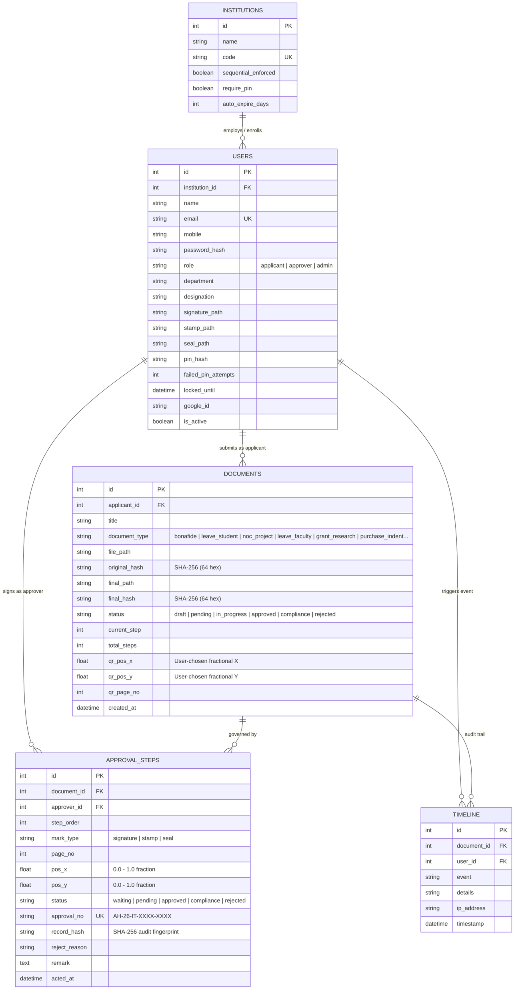

# 🚀 ApproveHub — Complete Building Journey & Master Technical Report (v2.0)

> **Course:** EDI1 (ES26102), F.Y. B.Tech Information Technology, VIT Pune  
> **Team Leader:** Shreeyash Solunke  
> **Team Members:** Shreeyash Solunke, Shravani Borse, Shreya Sutar, Shreya Loya  
> **Project Scope:** Tamper-Evident Institutional Digital Document Approval System (Web, Mobile & Cloud Deployable)  
> **Technology Stack:** Python 3.11+, Flask 3.1, SQLite, SQLAlchemy 2.0, PyMuPDF (fitz) 2.1, Pillow, QRCode, HTML5/CSS3/JavaScript  

---

## 📑 Table of Contents
1. [Executive Summary & System Purpose](#1-executive-summary--system-purpose)
2. [Master Architecture & Relational Schema (5 Core Tables)](#2-master-architecture--relational-schema-5-core-tables)
3. [The 12 Real-World Engineering Problems & Implemented Solutions](#3-the-12-real-world-engineering-problems--implemented-solutions)
4. [Advanced Features & High-Impact Upgrades](#4-advanced-features--high-impact-upgrades)
   - [Hierarchical Cascading Approver Picker](#hierarchical-cascading-approver-picker)
   - [Dynamic Multi-Tier Approver Chains](#dynamic-multi-tier-approver-chains)
   - [Role-Tailored Document Category System](#role-tailored-document-category-system)
   - [Staff & Faculty Approval Requisitions](#staff--faculty-approval-requisitions)
   - [User-Defined Draggable QR Code Positioning](#user-defined-draggable-qr-code-positioning)
   - [Google Institutional SSO Integration](#google-institutional-sso-integration)
   - [Real-Time Document Tracking & Stepper Status](#real-time-document-tracking--stepper-status)
   - [Admin Document Control Center](#admin-document-control-center)
   - [Complete User Profile & Digital Asset Management](#complete-user-profile--digital-asset-management)
   - [Animated & Responsive Micro-Interactions](#animated--responsive-micro-interactions)
5. [Step-by-Step Code Walkthrough](#5-step-by-step-code-walkthrough)
6. [Cloud Hosting, Production Deployment & Custom Domain Setup](#6-cloud-hosting-production-deployment--custom-domain-setup)
7. [Automated Verification & Test Suite](#7-automated-verification--test-suite)
8. [Student Guide: How to Run, Test, and Make this Project Your Own](#8-student-guide-how-to-run-test-and-make-this-project-your-own)

---

## 1. Executive Summary & System Purpose

In educational institutions, physical document signoffs (such as leave applications, bonafide requests, grant requisitions, and purchase indents) suffer from physical delays, forgery risks, and undetectable tampering.

**ApproveHub** solves this with an institutional tamper-evident digital approval workflow:
1. **Cryptographic Fingerprint:** Every uploaded PDF is hashed using **SHA-256 (`original_hash`)** and stored as read-only.
2. **Cascading Authority Routing:** Applicants choose authorities dynamically through institutional hierarchies: **Branch → Designation → Authorized Person → Mark Type (Signature, Stamp, Seal)**.
3. **Draggable Canvas:** The applicant drags both the authority stamps and the official **verification QR code** onto an A4 preview canvas. Coordinates are recorded as **fractions ($0.0 \text{ to } 1.0$)**, preventing DPI/resolution mismatches.
4. **PIN-Guarded Signoff:** Approvers authenticate using a **hashed security PIN** with 5-attempt rate-limiting lockout.
5. **PyMuPDF Vector Stamping:** The backend compiles a stamped copy with vector badges, signature PNGs, and the verification QR code at the user's chosen position.
6. **Public Verification:** Anyone scanning the QR code or visiting `/verify/<approval_no>` can confirm the document's validity and check for tampering.

---

## 2. Master Architecture & Relational Schema (5 Core Tables)

ApproveHub uses 5 interconnected relational tables:



---

## 3. The 12 Real-World Engineering Problems & Implemented Solutions

| # | Challenge / Threat | Implemented Solution in ApproveHub | Code Location |
| :-: | :--- | :--- | :--- |
| **1** | **Fake Tick / Drawn Marks** | The mark carries a unique short code (`AH-26-IT-XXXX-XXXX`) and a QR code linking to `/verify/<approval_no>`. A drawn or copied tick has no matching database entry. | `backend/utils/stamping.py`<br>`backend/routes/verification.py` |
| **2** | **Screen vs. PDF Coordinate Drift** | Normalized coordinates are stored as fractions ($0.0 \le x, y \le 1.0$). At stamping time, the server multiplies by the real PDF page width ($595\text{ pt}$) and height ($842\text{ pt}$). | `web/static/js/app.js`<br>`backend/utils/stamping.py` |
| **3** | **Text Overlap & Page Bleed** | Stamping engine clamps coordinates with an 18 pt margin ($18 \le x \le \text{width} - 193$). UI includes a 1-tap "Standard Bottom Positions" button. | `backend/utils/stamping.py`<br>`web/templates/place_marks.html` |
| **4** | **Post-Approval File Tampering** | Server calculates SHA-256 at upload (`original_hash`) and after stamping (`final_hash`). Hash re-verification occurs before every approver action and download. | `backend/utils/hashing.py`<br>`backend/routes/documents.py` |
| **5** | **Mid-Approval Document Alterations** | Uploaded documents are read-only. If an approver requests changes, the compliance flow uploads a revision with a fresh hash while retaining the audit history. | `backend/routes/approvals.py` |
| **6** | **Credential Theft / Unauthorized Signoff** | Approvers must enter a 4-6 digit PIN to approve. 5 consecutive wrong PIN entries locks the account for 15 minutes (`failed_pin_attempts`, `locked_until`). | `backend/models.py`<br>`backend/routes/auth.py` |
| **7** | **Multi-Step Stamping Degradation** | The original PDF is kept untouched. Stamping runs once upon final approval, compiling all marks cleanly in a single pass. | `backend/utils/stamping.py` |
| **8** | **Mobile Drag Imprecision** | Drag marks snap to a 5% grid on the canvas, with large touch targets and default bottom placements. | `web/static/js/app.js` |
| **9** | **Unsafe or Huge Uploads** | Restricted to PDF only, 10MB file size limit, and `%PDF-` magic-byte verification to reject disguised executables. | `backend/utils/validators.py` |
| **10**| **Ambiguous State Transitions** | Explicit state machines: Document (`draft` → `pending` → `in_progress` → `approved`/`rejected`/`compliance`); Steps (`waiting` → `pending` → `approved`). | `backend/models.py`<br>`backend/routes/approvals.py` |
| **11**| **Timestamp Falsification** | All timestamps (`acted_at`, `timestamp`) use server UTC (`datetime.now(timezone.utc)`), never the client device clock. | `backend/models.py`<br>`backend/routes/approvals.py` |
| **12**| **Academic / Legal Clarity** | Formally documented as an **"Institutional Tamper-Evident Digital Approval System"** using cryptographic audit trails and deterministic hashing. | `docs/architecture/database_schema.md` |

---

## 4. Advanced Features & High-Impact Upgrades

### Hierarchical Cascading Approver Picker
Users select approvers through three linked dropdowns:
1. **Branch / Department:** IT, Computer Engineering, Electronics, Mechanical, Administration.
2. **Designation / Post:** Professor, HOD, Dean, Registrar, Controller of Examinations.
3. **Authorized Person:** Populated dynamically via `/api/hierarchy/options`.
4. **Mark Type:** Radio options for **Signature**, **Stamp**, or **Seal**.

### Dynamic Multi-Tier Approver Chains
- Users can create a **single-approver flow** (e.g., just Class Teacher) or click **`➕ Add Another Approver Tier`** to create a multi-level sequential chain (e.g. Teacher → HOD → Dean → Principal).
- Each tier can be removed with the **`✕`** button.

### Role-Tailored Document Category System
When submitting a request, the category selection bar adapts based on the user's role:
- **Students:** Bonafide Certificate, Leave Application, Project / Internship NOC, Railway Concession, Scholarship Form, Letter of Recommendation (LOR).
- **Teachers / Staff / Faculty:** Casual / Duty Leave, Research Grant Requisition, Lab Equipment Purchase Indent, Budget Approval, Faculty NOC, Exam Duty Clearance.

### Staff & Faculty Approval Requisitions
Faculty and staff members have dual capability: they can approve documents in their **Approval Desk** and submit their own administrative requests via **Submit Request** in their sidebar.

### User-Defined Draggable QR Code Positioning
The public verification QR code is an interactive draggable badge on the A4 preview canvas. Applicants can place it in the top-right, bottom-right, or anywhere suitable to avoid covering text. Coordinates are stored in `qr_pos_x`, `qr_pos_y` and stamped by PyMuPDF.

### Google Institutional SSO Integration
One-click authentication using Google SSO (`/auth/google`) enables instant sign-in without manual password entry.

### Real-Time Document Tracking & Stepper Status
Every document features a live status tracking banner:
- Shows the active authority currently holding the document (e.g., *“Currently at Desk of: Dr. R. Patil (HOD - Information Technology)”*).
- Displays a visual progress bar with colored segments for each step.
- Displays an append-only audit trail logging every action with timestamps and actor details.

### Admin Document Control Center
Available at `/admin/documents`:
- Filter tabs: **All**, **Pending Review**, **Approved & Stamped**, **In Compliance**, and **Rejected**.
- Live search bar filtering by document title, ID, or applicant name.
- Direct link to inspect any document's full tracking history.

### Complete User Profile & Digital Asset Management
Available at `/profile`:
- Personal and institutional details (Name, Email, Mobile, Department, Designation).
- Security PIN management (change PIN, rate-limit status).
- Official signature and stamp PNG upload with live asset status indicators.

### Animated & Responsive Micro-Interactions
- Smooth animations: `@keyframes fadeInUp`, `@keyframes pulseGlow`, `@keyframes floatGentle`.
- Clean card elevations and interactive button hover effects.
- Topbar **`📱 Switch to App View`** button toggles between full desktop web view and an interactive mobile smartphone shell.

---

## 5. Step-by-Step Code Walkthrough

- **`backend/config.py`**: Configuration, secret keys, file size limits (10MB), and upload folder paths.
- **`backend/models.py`**: 5 SQLAlchemy tables (`Institution`, `User`, `Document`, `ApprovalStep`, `Timeline`) with password/PIN hashing and rate-limiting methods.
- **`backend/utils/hashing.py`**: Streaming chunked SHA-256 hashing (`sha256_file`), tamper checking (`verify_file`), and audit record hashing (`generate_record_hash`).
- **`backend/utils/validators.py`**: File type and `%PDF-` magic-byte verification.
- **`backend/utils/security.py`**: Authentication decorators (`@login_required`, `@role_required`) and random code generation (`AH-26-IT-XXXX-XXXX`).
- **`backend/utils/stamping.py`**: PyMuPDF vector stamping engine, fractional coordinate mapping, dynamic QR code generation, and final hash storage.
- **`backend/routes/auth.py`**: Login, registration, Google SSO, profile updates, PIN setup, and hierarchy API.
- **`backend/routes/documents.py`**: Document uploads, cascading mark placements, document tracking, and secure downloads.
- **`backend/routes/approvals.py`**: Approver inbox, PIN authentication, state machine progression, and compliance resolution.
- **`backend/routes/verification.py`**: Public verification portal (`/verify/<approval_no>`) and "Upload to Verify" SHA-256 checker.
- **`backend/routes/admin.py`**: Overview analytics, document control center, hierarchy builder, user directory, and CSV audit export.
- **`backend/fixtures.py`**: Database seeder pre-populating realistic college users and sample requests.

---

## 6. Cloud Hosting, Production Deployment & Custom Domain Setup

To make ApproveHub accessible to anyone on the internet with a custom domain, use **Render.com** (recommended, free tier, automatic HTTPS) or **PythonAnywhere**:

### Option A: Deploying on Render.com (Recommended)
1. **Push to GitHub:** Ensure your code is pushed to your GitHub repository:
   ```bash
   git push origin main
   ```
2. **Create Web Service on Render:**
   - Go to [render.com](https://render.com) and sign in with GitHub.
   - Click **New +** → **Web Service**.
   - Select your `ApproveHub` repository.
   - Configure the service:
     - **Name:** `approvehub`
     - **Runtime:** `Python 3`
     - **Build Command:** `pip install -r requirements.txt`
     - **Start Command:** `gunicorn wsgi:app`
   - Click **Create Web Service**. Render will build and deploy the app at `https://approvehub.onrender.com`.

3. **Connecting a Custom Domain:**
   - In Render, navigate to **Settings** → **Custom Domains**.
   - Enter your domain (e.g. `approvehub.yourdomain.com`).
   - Add the provided **CNAME** record in your domain registrar's DNS settings (GoDaddy, Namecheap, Cloudflare, etc.):
     - **Type:** `CNAME`
     - **Name / Host:** `approvehub`
     - **Value / Target:** `approvehub.onrender.com`
   - Render automatically provisions an SSL certificate (HTTPS) within minutes.

### Production Files Provided:
- **`wsgi.py`**: WSGI entry point for production application servers.
- **`Procfile`**: Process configuration for Gunicorn execution.
- **`requirements.txt`**: Locked dependencies for clean cloud builds.

---

## 7. Automated Verification & Test Suite

The test suite in `test_system_flow.py` verifies all critical functions:
- `test_01_public_verify_seeded_document`: Verifies the public verification portal displays valid approval status.
- `test_02_pin_brute_force_protection`: Verifies 5 wrong PIN attempts triggers account lockout.
- `test_03_tamper_detection`: Verifies altering even one byte in a document triggers a hash mismatch.
- `test_04_full_approval_and_stamping_flow`: Verifies the multi-step approval sequence, PIN authentication, PyMuPDF stamping, QR generation, and final hash storage.

Run tests anytime with:
```bash
python test_system_flow.py
```
**Output:**
```text
Ran 4 tests in 1.260s

OK
```

---

## 8. Student Guide: How to Run, Test, and Make this Project Your Own

### Step 1: Starting the Server Locally
In your terminal, navigate to the project directory and run:
```powershell
python app.py
```
Open your browser to: **`http://127.0.0.1:5000`**

### Step 2: Testing Demo Roles (1-Click Switcher)
On the login screen (`/login`), click any quick demo button:
1. **👨‍🎓 Shreeyash (Applicant):** Submit new requests, choose document types, select cascading authorities, and drag marks and QR codes on the A4 canvas.
2. **👩‍🏫 Prof. Meera (Authority 1):** Review pending requests, verify the live PDF, and approve using PIN `1234`.
3. **👨‍💼 Dr. Patil (HOD / Authority 2):** Grant final approval with PIN `1234` to trigger PyMuPDF vector stamping and QR generation.
4. **⚙️ Admin:** Access the institutional hierarchy builder, user directory, document control center, and export audit logs to CSV.
5. **🔍 Public Portal:** Visit `http://127.0.0.1:5000/verify/AH-26-IT-0412-7KQ3` to test live verification.
