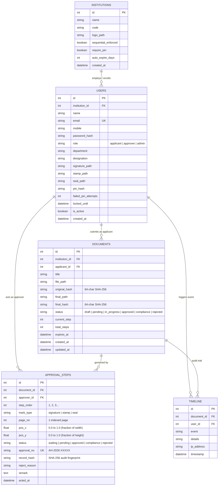

# ApproveHub — Relational Database Schema & System Architecture Blueprint

> **Course:** EDI1 (ES26102), F.Y. B.Tech IT, VIT Pune  
> **Milestone:** Step 4 (Phase 0 — Setup & Planning)  
> **Author & Lead:** Shreeyash Solunke  
> **Deliverable:** Master Database Schema, ER Diagram, Coordinate Mathematics, & Security Architecture  

---

## 1. System Architecture & Core Workflow

ApproveHub is an institutional tamper-evident digital document approval system. The workflow strictly follows these rules:

1. **Submission & Ingestion:**
   - Applicant uploads an official PDF (max 10MB, MIME-type and magic-byte verified).
   - The backend immediately computes the **SHA-256 cryptographic fingerprint (`original_hash`)** and marks the original file as immutable (read-only).
2. **Dynamic Stamp Placement (Fractional Mathematics):**
   - The applicant chooses sequential approvers from the institutional hierarchy (e.g., Professor → HOD → Dean).
   - For each approver, a placement mark is positioned on an A4 preview canvas.
   - Positions are stored as **fractions from 0.0 to 1.0** (`pos_x`, `pos_y`, `page_no`), eliminating all screen DPI vs. PDF point scale mismatches.
3. **Sequential Decision Engine & Security PIN:**
   - Step 1 begins in `pending`; subsequent steps remain in `waiting`.
   - Approver reviews the original PDF and authenticates with a **6-digit security PIN**.
   - Failed PIN attempts are throttled (locked for 15 minutes after 5 consecutive failures).
4. **Server-Side Composite Mark Generation:**
   - The server dynamically renders an official institutional verification mark (approver's name, designation, server timestamp, and unique `approval_no`). The applicant never provides external stamp images.
   - The server creates a cryptographically signed approval audit record (`record_hash`).
5. **Final Stamping & Public Verification:**
   - Once all approvers confirm, the backend (PyMuPDF) applies all marks to a fresh copy of the original document.
   - A dynamic QR code linking to `/verify/<approval_no>` is stamped on the final page.
   - The stamped file's SHA-256 fingerprint is recorded as `final_hash`.

---

## 2. Complete Entity-Relationship (ER) Diagram



---

## 3. Database Tables Specification

### 3.1 Table: `institutions` (Multi-Tenancy & Rules)
Supports institutional scoping, hierarchy rules, and custom policies.

| Column Name | SQL Type | Constraints | Description |
| :--- | :--- | :--- | :--- |
| `id` | INTEGER | PRIMARY KEY AUTOINCREMENT | Unique institution identifier |
| `name` | VARCHAR(150) | NOT NULL | Full institution name (e.g. "VIT Pune") |
| `code` | VARCHAR(20) | UNIQUE NOT NULL | Short code (e.g. "VITP") |
| `logo_path` | VARCHAR(255) | NULLABLE | Path to institutional emblem PNG |
| `sequential_enforced`| BOOLEAN | DEFAULT TRUE | Force step-by-step sequential approval |
| `require_pin` | BOOLEAN | DEFAULT TRUE | Require PIN verification for approvals |
| `auto_expire_days` | INTEGER | DEFAULT 14 | Days before unacted requests auto-expire |
| `created_at` | DATETIME | DEFAULT CURRENT_TIMESTAMP | Registered timestamp |

---

### 3.2 Table: `users` (Authentication, RBAC & Approver Assets)
Stores credentials, access roles, PIN security states, and digital stamping assets.

| Column Name | SQL Type | Constraints | Description |
| :--- | :--- | :--- | :--- |
| `id` | INTEGER | PRIMARY KEY AUTOINCREMENT | Unique user identifier |
| `institution_id` | INTEGER | FOREIGN KEY (`institutions.id`) | Institutional affiliation |
| `name` | VARCHAR(100) | NOT NULL | Full official name |
| `email` | VARCHAR(120) | UNIQUE NOT NULL | Official login email |
| `mobile` | VARCHAR(20) | NULLABLE | Contact mobile number |
| `password_hash` | VARCHAR(255) | NOT NULL | Salted PBKDF2/bcrypt password hash |
| `role` | VARCHAR(20) | NOT NULL (CHECK IN: `'applicant'`, `'approver'`, `'admin'`) | System RBAC authorization role |
| `department` | VARCHAR(100) | NULLABLE | Department (e.g. "Information Technology") |
| `designation` | VARCHAR(100) | NULLABLE | Designation (e.g. "Professor", "HOD", "Dean") |
| `signature_path` | VARCHAR(255) | NULLABLE | Storage path for approver signature PNG (transparent) |
| `stamp_path` | VARCHAR(255) | NULLABLE | Storage path for approver department stamp PNG |
| `seal_path` | VARCHAR(255) | NULLABLE | Storage path for official college seal PNG |
| `pin_hash` | VARCHAR(255) | NULLABLE | Salted hash of 4-6 digit security PIN |
| `failed_pin_attempts`| INTEGER | DEFAULT 0 | Counter for brute-force rate-limiting |
| `locked_until` | DATETIME | NULLABLE | Lockout expiry time if >5 wrong PIN attempts |
| `is_active` | BOOLEAN | DEFAULT TRUE | Account state toggle |
| `created_at` | DATETIME | DEFAULT CURRENT_TIMESTAMP | Account creation time |

---

### 3.3 Table: `documents` (Uploaded Artifacts & Cryptographic Fingerprints)
Stores document metadata, workflow progress, and integrity hashes.

| Column Name | SQL Type | Constraints | Description |
| :--- | :--- | :--- | :--- |
| `id` | INTEGER | PRIMARY KEY AUTOINCREMENT | Unique document identifier |
| `institution_id` | INTEGER | FOREIGN KEY (`institutions.id`) | Owning institution |
| `applicant_id` | INTEGER | FOREIGN KEY (`users.id`) ON DELETE RESTRICT | User who submitted the document |
| `title` | VARCHAR(200) | NOT NULL | Subject / title of the request |
| `file_path` | VARCHAR(255) | NOT NULL | Path to original immutable uploaded PDF |
| `original_hash` | CHAR(64) | NOT NULL | SHA-256 fingerprint of original file |
| `final_path` | VARCHAR(255) | NULLABLE | Path to stamped final PDF (populated on completion) |
| `final_hash` | CHAR(64) | NULLABLE | SHA-256 fingerprint of final stamped PDF |
| `status` | VARCHAR(30) | DEFAULT 'pending' (CHECK IN: `'draft'`, `'pending'`, `'in_progress'`, `'approved'`, `'compliance'`, `'rejected'`) | Global workflow status |
| `current_step` | INTEGER | DEFAULT 1 | Step number currently under review |
| `total_steps` | INTEGER | DEFAULT 1 | Total count of steps in approval chain |
| `expires_at` | DATETIME | NULLABLE | Workflow deadline timestamp |
| `created_at` | DATETIME | DEFAULT CURRENT_TIMESTAMP | Submission timestamp (server clock) |
| `updated_at` | DATETIME | DEFAULT CURRENT_TIMESTAMP | Last modification timestamp |

---

### 3.4 Table: `approval_steps` (Sequential Chain, Coordinates & Cryptographic Signoff)
Controls individual review stages, fractional placement coordinates, and approval tokens.

| Column Name | SQL Type | Constraints | Description |
| :--- | :--- | :--- | :--- |
| `id` | INTEGER | PRIMARY KEY AUTOINCREMENT | Unique step identifier |
| `document_id` | INTEGER | FOREIGN KEY (`documents.id`) ON DELETE CASCADE | Parent document |
| `approver_id` | INTEGER | FOREIGN KEY (`users.id`) ON DELETE RESTRICT | Assigned authority |
| `step_order` | INTEGER | NOT NULL | Sequential execution order (`1`, `2`, `3`...) |
| `mark_type` | VARCHAR(20) | DEFAULT 'signature' (CHECK IN: `'signature'`, `'stamp'`, `'seal'`) | Type of mark to apply |
| `page_no` | INTEGER | DEFAULT 1 | 1-indexed PDF page number for mark placement |
| `pos_x` | FLOAT | NOT NULL | **Fractional X coordinate** ($0.0 \le x \le 1.0$) |
| `pos_y` | FLOAT | NOT NULL | **Fractional Y coordinate** ($0.0 \le y \le 1.0$) |
| `status` | VARCHAR(20) | DEFAULT 'waiting' (CHECK IN: `'waiting'`, `'pending'`, `'approved'`, `'compliance'`, `'rejected'`) | Step review status |
| `approval_no` | VARCHAR(30) | UNIQUE NULLABLE | Random verification token: `AH-2026-[A-Z0-9]{6}` |
| `record_hash` | CHAR(64) | NULLABLE | SHA-256 of composite signoff data |
| `reject_reason` | VARCHAR(100) | NULLABLE | Standard rejection category preset |
| `remark` | TEXT | NULLABLE | Notes or explanation from approver |
| `acted_at` | DATETIME | NULLABLE | Server timestamp when action was recorded |

---

### 3.5 Table: `timeline` (Immutable Audit Trail)
Maintains an append-only chronological history of every action taken in the system.

| Column Name | SQL Type | Constraints | Description |
| :--- | :--- | :--- | :--- |
| `id` | INTEGER | PRIMARY KEY AUTOINCREMENT | Unique audit entry identifier |
| `document_id` | INTEGER | FOREIGN KEY (`documents.id`) ON DELETE CASCADE | Target document |
| `user_id` | INTEGER | FOREIGN KEY (`users.id`) ON DELETE SET NULL | Actor responsible for the event |
| `event` | VARCHAR(100) | NOT NULL | Event name (e.g., `'DOCUMENT_UPLOADED'`, `'STEP_APPROVED'`) |
| `details` | TEXT | NULLABLE | Human-readable explanation and metadata |
| `ip_address` | VARCHAR(45) | NULLABLE | Client IP address for institutional audit |
| `timestamp` | DATETIME | DEFAULT CURRENT_TIMESTAMP | Server-generated timestamp |

---

## 4. Coordinate Mathematics: Bridging Screen Pixels & PDF Points

### The Problem (Problem #2)
- **Browser Screen:** Rendered using CSS pixels where $(0,0)$ is top-left, and dimensions depend on device resolution (e.g. 794px × 1123px).
- **PDF Engine (PyMuPDF):** Measured in typographical points ($72 \text{ points} = 1 \text{ inch}$). An A4 page is $595 \times 842 \text{ points}$.

### The Mathematical Solution (Fractional Normalization)
All coordinates are converted to normalized fractions between $0.0$ and $1.0$ at placement time:

$$\text{pos\_x} = \frac{\text{client\_x}}{\text{preview\_width}}, \quad \text{pos\_y} = \frac{\text{client\_y}}{\text{preview\_height}}$$

At server stamping time:
```python
# Real page dimension in points from PyMuPDF
page_width = page.rect.width   # e.g., 595.0 pt
page_height = page.rect.height # e.g., 842.0 pt

# Convert fractional coordinates back to points
stamp_x0 = pos_x * page_width
stamp_y0 = pos_y * page_height

# Standard stamp dimension in points (e.g. 140 pt wide, 50 pt high)
stamp_w = 140.0
stamp_h = 50.0

# Clamp to prevent edge bleeding (Problem #3)
stamp_x0 = min(max(20.0, stamp_x0), page_width - stamp_w - 20.0)
stamp_y0 = min(max(20.0, stamp_y0), page_height - stamp_h - 20.0)

stamp_rect = fitz.Rect(stamp_x0, stamp_y0, stamp_x0 + stamp_w, stamp_y0 + stamp_h)
```

---

## 5. Security & Architectural Protection Mapping

| # | Threat / Edge Case | Architectural Defense in Schema & Engine |
| :-: | :--- | :--- |
| **1** | **Fake Tick / Drawn Mark** | Stamped mark displays dynamic `approval_no` (e.g. `AH-2026-X9K2L1`). QR code links directly to public verification URL. Any mark without a valid database record fails verification. |
| **2** | **DPI & Coordinate Drift** | Normalized fractional coordinates ($0.0 \le \text{pos\_x}, \text{pos\_y} \le 1.0$) stored in `approval_steps`. Scaled at runtime to exact PDF points. |
| **3** | **Text Overlap & Page Bleed** | Boundary clamping in backend ($20 \le x \le \text{width} - 160$); overlap detection warning algorithm runs on both UI and backend. Default position pre-placed on bottom margin of last page. |
| **4** | **Post-Approval Tampering** | Initial SHA-256 stored in `documents.original_hash`. Final SHA-256 stored in `documents.final_hash`. Any modified byte produces a mismatch. |
| **5** | **Mid-Approval Document Alteration** | Original uploaded file is locked as read-only. Requests cannot be edited mid-flight; compliance requires uploading a new revision with a new hash log. |
| **6** | **Credential Theft / Unauthorized Signoff**| Approvers must input their 4-6 digit `pin_hash`. The system locks the account after 5 consecutive failed attempts (`failed_pin_attempts` $\ge 5$, `locked_until = now() + 15m`). |
| **7** | **Multi-Step Stamping Degradation** | Incremental re-compression is prevented. PyMuPDF creates a single stamped output from the pristine original document only when the final approver signs off. |
| **8** | **Mobile Drag Imprecision** | Frontend supports touch handles, snap-to-grid (10% increments), and 1-tap "Use Standard Placement" fallback. |
| **9** | **Malicious or Oversized Files** | Strict 10MB limit; validation parses the PDF header `%PDF-` magic bytes; files are stored outside the web root (`uploads/docs/`) with UUID filenames. |
| **10**| **Ambiguous State Transitions** | State machine enforced: Document is in `['draft', 'pending', 'in_progress', 'approved', 'compliance', 'rejected']`. Step is in `['waiting', 'pending', 'approved', 'compliance', 'rejected']`. |
| **11**| **Timestamp Falsification** | All timestamps (`acted_at`, `created_at`, `timestamp`) are generated strictly using server UTC time (`datetime.utcnow()`), never client timestamps. |
| **12**| **Academic / Legal Clarity** | Documented accurately as a **"Tamper-Evident Institutional Approval System"** using cryptographic audit trails and deterministic hashing. |

---

## 6. High-Impact Low-Effort Features

1. **Public Verification Portal (`GET /verify/<approval_no>`):**
   - No login needed. Anyone scanning the QR code sees: Approver name, designation, approval timestamp, document title, and a green badge: **"Document Unchanged & Cryptographically Verified ✔"**.
2. **"Upload to Verify" Hash Check:**
   - A public page where an examiner or student drops a PDF. The server calculates the SHA-256 hash and matches it against `final_hash`. Instant red/green result.
3. **Professional Server-Generated Composite Mark:**
   - Rather than raw ticks, server renders an institutional badge containing:
     - Verified Green Shield icon
     - Approver Name & Designation
     - Approval Timestamp & ID
4. **Suggested Default Positions:**
   - If applicant does not drag, marks automatically arrange horizontally along the bottom margin of the last page.
5. **Dashboard Quick Metrics:**
   - Simple SQL queries power applicant/approver counter tiles (`active`, `done`, `rejected`).
6. **Chronological Visual Timeline:**
   - Reads directly from `timeline` table ordered by `timestamp ASC`, presenting a clean vertical timeline.
